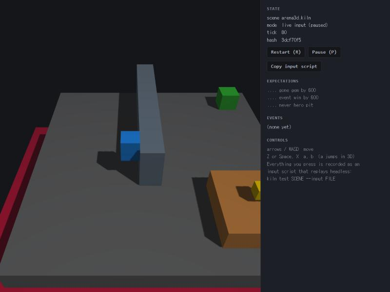

# Kiln

[English](README.md) | 한국어

사람이 아니라 **AI 에이전트가 1급 사용자**인 오픈소스 게임 엔진입니다.

**[브라우저에서 예제 플레이하기](https://seojunlee-code.github.io/kiln/)** — 이 저장소를 `kiln build`로 빌드한 결과입니다. 메뉴에서 장면을 고를 수 있습니다.

기존 게임 엔진은 사람이 에디터 화면을 보는 것을 전제로 합니다. 에이전트가 쓰면 그만큼 비용이 듭니다. 씬 파일이 장황하고, 결과를 화면을 봐야만 확인할 수 있고, 실행할 때마다 결과가 달라집니다. Kiln은 반대로 설계했습니다.

- **전부 텍스트.** 씬은 짧고 diff가 되는 파일입니다. 에디터가 필요 없습니다.
- **결정론 코어.** 고정 틱, 고정소수점 연산, 고정된 시스템 순서. 같은 씬과 입력이면 같은 상태 해시가 나오고, CI가 Linux·macOS·Windows에서 이를 확인합니다.
- **헤드리스 검증.** `kiln test`가 창 없이 씬을 돌려, 씬 안에 쓴 `expect` 줄을 검사합니다.
- **값싼 관측.** 스크린샷 대신 ASCII 그림과 엔티티당 한 줄.
- **기계가 읽는 오류.** 오류마다 코드, `파일:줄`, 수정 힌트가 붙고 한 번에 전부 보고합니다.
- **엔진이 자기 레벨을 직접 플레이.** `kiln solve`가 목표를 만족하는 입력을 탐색해, 아무도 플레이하지 않아도 레벨을 깰 수 있음을 보여 줍니다.
- **MCP 도구 하나.** 에이전트가 MCP로 연결하면 엔진 전체가 도구 하나로 들어옵니다.



## 현재 수준

만든 지 며칠 된 프로젝트입니다. 장기 목표는 에이전트가 프로토타입부터 출시까지 끌고 갈 수 있는 엔진, 즉 사람 팀에게 언리얼이나 Godot가 하는 역할입니다. 지금은 상자 모양 세계를 위한 작은 코어이고, 2D와 3D, 모델·머티리얼·강체의 첫 단계까지 됩니다.

| 지금 되는 것 | 아직 안 되는 것 |
|---|---|
| 텍스트 씬, 내장 구성요소 30개, 글자 격자로 그리는 레벨, 프리팹 | 사용자 셰이더, 애니메이션 블렌딩·IK, 점광원 그림자 |
| x·y·z 고정소수점 시뮬레이션, 스윕 충돌, 트리거, 순찰하는 적, 밀 수 있는 상자, 움직이는 발판 | 원·다각형 충돌, 회전을 따르는 충돌 |
| 회전(각도 `rot`, 사원수 `quat`): 2D와 WebGPU가 그림 | 부모-자식 변환 |
| 강체(상자·공·캡슐·원기둥·원뿔)와 조인트 6종(선택형 백엔드 Rapier 결정론 빌드): 캐릭터를 막고 밀며 `solve`도 통과 | 2D 강체, 메시 충돌체, 끊어지는 조인트 |
| 격자 경로 찾기(`nav`): 벽을 돌아 목표까지 | 내비메시, 서로 피하기 |
| 롤백 네트워크 대전(`world players=2`)과 중계 서버 | 로비, 재접속, 권위 서버 |
| 2D: 스프라이트와 스프라이트 애니메이션, 타일 문자별 색·이미지, 글자 라벨, 버튼, 화면 고정 | 파티클, 배치 컨테이너, 글자 입력 |
| 이벤트별 소리 파일, 반복 음악 한 곡 | 위치 음향, 페이드 |
| 키보드, 터치, 게임패드 | 키 다시 배정, 아날로그 값 |
| 레벨 이동, 점수·목숨 넘기기(`tally`, `keep`) | 디스크 저장 |
| 실패 이유를 설명하는 `expect` 검사, 결정론 검사가 붙은 TypeScript 스크립트 | 에셋 파이프라인 |
| 브라우저 플레이어(2D, 그림자 있는 3D, OBJ 메시). 3D는 WebGPU로 그리고 없으면 WebGL2 | 3D 화면의 이미지·글리프·라벨 |
| glTF 2.0 모델과 PBR 머티리얼·텍스처(WebGPU) | 모프 타깃, 환경광, Godot 밖 도구가 만든 파일 확인 |
| `look`: 헤드리스 브라우저로 그린 화면을 에이전트에게 그림으로 돌려줌 | 사람용 에디터, 프로파일러 |
| `solve`: 레벨을 깨는 입력 자동 탐색 | `solve`는 버튼을 누르지 않음 |
| `build`(정적 웹 내보내기), `new`, MCP 서버, CLI | 데스크톱·모바일 내보내기 |

Claude Code가 MCP 서버로 연결해 게임을 만든 실행 기록이 있습니다([proof/lite](proof/lite/RUN.md), [proof/compare](proof/compare/README.md)). 보류용 명세로 Godot와 비교하는 중이며 승패는 아직 없습니다. 알려진 결함 하나: 오래 떠 있는 MCP 서버가 고친 게임 스크립트를 다시 읽지 않습니다. 사람이 직접 플레이 테스트한 적은 아직 없습니다. 자세한 상태와 한계는 [HANDOFF.md](HANDOFF.md)에 있습니다.

## 써 보기

Node 24 이상이 필요합니다. 의존성도 빌드 단계도 없습니다.

```
git clone https://github.com/SeoJunLee-code/kiln
cd kiln
npm test
node src/cli.ts solve examples/vault.kiln
node src/cli.ts play examples/platformer.kiln
```

`play`가 열어 주는 페이지에서 사람이 에이전트가 한 일을 확인합니다. `,`와 `.`로 실행을 한 틱씩 앞뒤로 넘기고, 개체를 눌러 컴포넌트를 읽습니다. `play SCENE --before OLD.kiln`(또는 `--before HEAD` 같은 git 리비전)은 바꾸기 전 게임을 지금 게임 옆에 놓고 같은 입력으로 돌리며 다른 점을 적어 줍니다.

## 에이전트로 게임 시작하기

```
node src/cli.ts new ../mygame
```

시작 씬, 에이전트용 작업 안내(`AGENTS.md`, `CLAUDE.md`), 엔진을 MCP 도구로 연결하는 `.mcp.json`이 만들어집니다. 그 폴더를 Claude Code로 열고 게임을 만들어 달라고 하면 됩니다. 엔진 전체 설명서는 `node src/cli.ts guide` 한 번으로 나옵니다(약 5,500자).

## 씬 예시

```
prefab coin
  box 0.5 0.5
  tag coin
  trigger hero coin despawn-self

entity map
  pos 0 0
  tiles spawn=@:hero,o:coin,D:door
    #########
    #@..#..o#
    #.#.#.#.#
    #o#...#D#
    #########

expect gone #coin by 600
```

## 정말 더 짧은가

측정은 지금까지 하나입니다. 미로 예제(플레이 기록과 검사 포함)가 Kiln으로 729자, 손으로 쓴 Godot 4 대응 구현으로 4,937자입니다. 게임 하나뿐이고, Godot 파일은 Godot에서 실행해 보지 않았으며, 실제 토크나이저로 토큰을 세지 않았습니다. 자세한 내용은 [bench/](bench/README.md)에 있습니다.

## 기여

이슈와 풀 리퀘스트를 환영합니다. [CONTRIBUTING.md](CONTRIBUTING.md)(영문)부터 보세요.

## 라이선스

MIT
