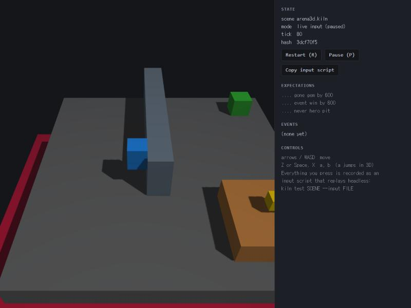
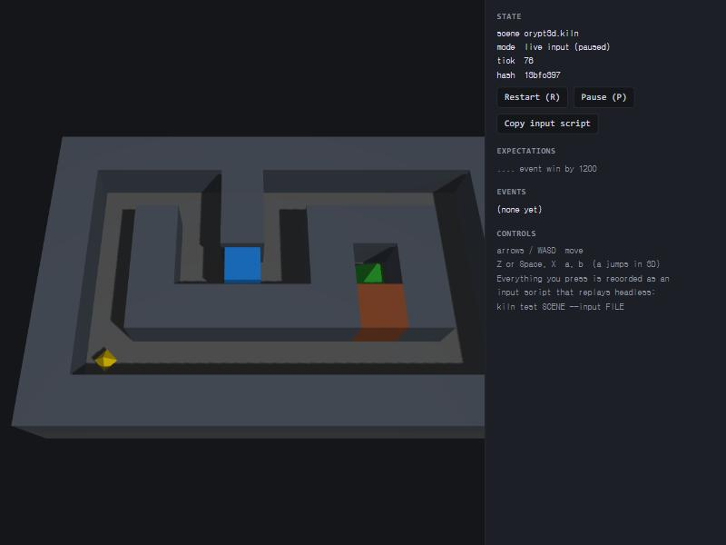

# Kiln

[](https://github.com/SeoJunLee-code/kiln/actions/workflows/ci.yml)

English | [한국어](README.ko.md)

An open-source game engine whose primary user is an AI agent, not a person in a GUI editor.

**[Play the examples in your browser](https://seojunlee-code.github.io/kiln/)** — built from this repository by `kiln build`; pick a scene from the menu. It has on-screen buttons on a phone.

Game engines assume a human looking at an editor window. An agent using them pays for that: verbose scene files, results it can only check by looking at pixels, and runs that differ every time. Kiln is designed the other way round.

- **Everything is text.** Scenes are short, diffable files. There is no required editor.
- **Deterministic core.** Fixed tick, fixed-point math, fixed system order. The same scene and input give the same state hash; CI checks this on Linux, macOS and Windows.
- **Headless verification.** `kiln test` runs a scene without a window and checks `expect` lines written in the scene itself.
- **Cheap observation.** An ASCII view and one line per entity instead of screenshots.
- **Machine-readable errors.** Every error has a code, a `file:line` and a hint, and all errors are reported in one pass. `check` also warns about parts of a scene that load but silently do nothing, such as a controller without a velocity or a trigger that points at a name nobody has.
- **The engine can play its own levels.** `kiln solve` searches for an input that meets a scene's goals, so a level is shown to be finishable without anyone playing it.
- **One MCP tool.** An agent connects over MCP and gets the whole engine as a single tool.



## Where it stands

Kiln is a few days old. The long-term aim is an engine that agents can take from prototype to a shipped, good-looking game — the role Unreal and Godot play for human teams. Today it is a small core: box-shaped worlds in 2D and 3D, with first steps into models, materials and rigid bodies.

| Works today | Not yet |
|---|---|
| Text scenes, 18 built-in components, levels drawn as character grids with prefabs | Skeletal animation, custom shaders, more than one light |
| Fixed-point simulation on x, y and z; swept box collision; triggers that emit events and remove things (keys, doors, pickups); pacing guards; pushable crates; moving platforms that carry what stands on them | Collision that follows rotation, joints |
| Rotation as fixed-point state: an angle (`rot`) or a quaternion (`quat`), drawn in 2D and by WebGPU | Parent-child transforms |
| Rigid bodies (boxes and balls) through an optional backend, Rapier's deterministic build: same hash on Linux, macOS and Windows, and `solve` searches through them | Rigid bodies that block the character; other shapes |
| `expect` checks with explanations on failure | Animation, UI widgets |
| TypeScript scripts with a determinism check | Asset pipeline beyond single images |
| Browser player: Canvas 2D, and lit, shadowed boxes and OBJ meshes for 3D scenes, drawn with WebGPU (WebGL2 where the browser has none) | Images in 3D |
| glTF 2.0 models (.glb, .gltf) with metallic-roughness materials and textures, on WebGPU | glTF animation and skins; files from other exporters are untested; environment lighting |
| `look`: the scene drawn in a headless browser, returned to the agent as a picture | |
| Several levels (a trigger loads the next scene), text labels, a tone per event | Music, sound files, menus |
| `solve`: automatic search for a winning input |  |
| `build`: export to a static web folder |  |
| MCP server, CLI | Networking, desktop and mobile export |

No human has play-tested it yet, and the MCP server has only been exercised by its own tests. See [HANDOFF.md](HANDOFF.md) (Korean) for the detailed status and known limits.

## Try it

Needs Node 24 or newer. No dependencies, no build step. (Rigid-body scenes need one optional package: `npm ci --prefix backends/rapier`.)

```
git clone https://github.com/SeoJunLee-code/kiln
cd kiln
npm test
node src/cli.ts test examples/platformer.kiln --input examples/platformer.input --view
node src/cli.ts play examples/platformer.kiln
```

For the 3D example, open the printed URL with `?scene=arena3d.kiln` (arrows or WASD to walk, Space to jump).

`play` prints a local URL; add `?scene=cave.kiln` to open another scene from the same folder. What you press there is recorded as an input script, so a play session can be replayed headless with `kiln test SCENE --input FILE` and gives the same state hash.

## Start a game with an agent

```
node src/cli.ts new ../mygame
```

This writes a starter scene, an `AGENTS.md` (and `CLAUDE.md`) that tells an agent how to work with Kiln, and a `.mcp.json` that connects the engine as an MCP tool. Open the folder in Claude Code, or any agent that reads those files, and ask for a game.

## Ship it

```
node src/cli.ts build mygame/level1.kiln --out dist
```

`dist` then holds the player, the engine modules it needs and everything next to the scene, as plain files any static host can serve (GitHub Pages, itch.io, an S3 bucket). The demo linked at the top is produced this way on every push.

## A scene

```
world hz=60 gravity=0,30

entity hero
  pos 1 9
  box 0.8 1
  vel
  body
  ctrl 5 12

entity ground
  pos 0 10
  box 20 1
  solid

entity flag
  pos 15 9
  box 1 1
  trigger hero win

expect event win by 300
expect at 300 hero.body.grounded == 1
```

Levels can be drawn as a grid, one character per cell. Characters named in `spawn` become entities built from a prefab (see [examples/dungeon.kiln](examples/dungeon.kiln)):

```
prefab coin
  box 0.5 0.5
  tag coin
  trigger hero coin despawn-self

entity map
  pos 0 0
  tiles spawn=@:hero,o:coin,D:door
    #########
    #@..#..o#
    #.#.#.#.#
    #o#...#D#
    #########

expect gone #coin by 600
```

Values are positional or `name=value`. `node src/cli.ts schema` prints the component reference in a compact form meant to be pasted into an agent's context.

Expectations (`A` and `B` are entity names or `#tags`):

| Form | Passes when |
|---|---|
| `reach A B by N` | A overlaps B at some tick ≤ N |
| `never A B` | A never overlaps B during the run |
| `gone A by N` | A was despawned by tick N |
| `event NAME by N` | a trigger emitted NAME by tick N |
| `count NAME OP VALUE at N` | the number of NAME events by tick N compares true |
| `at N A.comp.field OP VALUE` | the comparison holds at tick N |

When a check fails, the output says what happened instead:

```
FAIL examples/maze.kiln:45 reach player exit by 240 -- closest gap 5.2 at tick 0, player at 1,1
```

Input scripts are one `TICK ACTION down|up` per line. Actions: `left right up down a b`.

## Let the engine prove a level can be finished

```
$ node src/cli.ts solve examples/cave.kiln --out cave.input
0 right down
...
ok solved tick=250 states=2507 wrote=cave.input
```

Because a run is fully determined by scene and input, the engine can search the input space: over which keys are held for the next few ticks, merging states that are the same. An answer is replayed through the normal path before it is reported. If nothing works it says which goal is still open and draws where its furthest attempt ended:

```
fail no input reaches the goals by tick 120; best run met 0/1, still open: gone gem by 120
furthest attempt, tick 20:
origin 0,0
#######
#.h#.g#
#######
fail tick=20 states=94
```

Thirteen of the fourteen examples solve in under a second on one laptop, and the largest ([examples/quest.kiln](examples/quest.kiln): a key, a door and a guard sweeping the corridor) in a little over one. They include the 3D one, a crate-pushing puzzle ([examples/sokoban.kiln](examples/sokoban.kiln)), a gap that can only be crossed by riding a lift ([examples/lift.kiln](examples/lift.kiln)), a key-and-door puzzle ([examples/vault.kiln](examples/vault.kiln)) and a corridor of pacing guards where the crossing has to be timed ([examples/gauntlet.kiln](examples/gauntlet.kiln)). The search tries inputs that get nearer to a goal first; it has only been tried with one controllable character in small levels, and it gives up (and says so) when it runs out of states. `at` expectations are not searched for.

## 3D

`pos`, `vel` and `box` take an optional third value, and a scene that uses it is simulated on three axes with the same code and the same guarantees. Adding an `eye` component makes the player draw it in perspective (see [examples/arena3d.kiln](examples/arena3d.kiln)):

```
world hz=60 gravity=0,30

entity hero
  pos 1 -1 1
  box 0.8 1 0.8
  vel
  body
  ctrl 5 10 xz
  eye 0 -8 9

entity floor
  pos 0 0 0
  box 12 1 12
  solid
```

A 3D level can also be drawn as a floor plan. `plane=xz` lays a tile map flat, with `depth` as the wall height ([examples/crypt3d.kiln](examples/crypt3d.kiln)):

```
entity map
  pos 0 -1 0
  tiles plane=xz spawn=@:hero,k:key,D:door,E:exit
    ###########
    #@..#.....#
    #.#.#.###.#
    #.#...#E#.#
    #.#####D#.#
    #k........#
    ###########
```



`--top` prints the same picture back as text, so an agent can check a 3D level without a screenshot.

`y` grows downward, so things above the floor have negative `y`. A sprite can name an OBJ file (`sprite color=gold mesh=gem.obj`); OBJ is text, so an agent can write one. The mesh is drawn fitted to the entity's box, while collision stays the box. One sun with shadows.

A sprite can also name a glTF model (`mesh=crate.glb`, or a `.gltf` with its `.bin` and images beside it). WebGPU draws it with its metallic-roughness materials and textures ([examples/gallery3d.kiln](examples/gallery3d.kiln)); `check` reports anything in the file that would not be drawn. `rot 25 axis=y` turns an entity about one axis and `quat` holds a full orientation; both are simulation state, in fixed-point, and both can spin ([examples/orrery3d.kiln](examples/orrery3d.kiln)).

Rigid bodies come from a physics backend. `world ... physics=rapier` turns it on and `rigid` marks a body; bodies stop the character, who shoves them along and can stand on them; `impulse x y z` gives a body one shove and `force x y z` a steady push (a script kicks a body by adding `impulse`); and `solve` finds the push that wins ([examples/tumble3d.kiln](examples/tumble3d.kiln)):

```
world hz=60 gravity=0,30 physics=rapier

entity ball
  pos 3.5 -0.8 4
  box 0.8 0.8 0.8
  rigid ball bounce=0.3
  sprite color=tomato mesh=ball.glb
```

## Scripts

A scene line `use ./game.ts` loads a script that adds components and systems. See [examples/patrol.ts](examples/patrol.ts).

```ts
export default (k) => {
  k.component('patrol', 'walks between x=min and x=max', [
    { name: 'min', type: 'fx' }, { name: 'max', type: 'fx' }, { name: 'speed', type: 'fx' }]);
  k.system((w) => {
    for (const id of w.query('patrol', 'pos', 'vel')) { /* ... */ }
  });
};
```

Scripts must stay deterministic. `Math.random`, `Date`, timers and similar are rejected at load (K121); use `w.rand()` and `w.tick`. The check is a simple text scan, so it catches the obvious cases only.

## Use from an agent (MCP)

```json
{ "mcpServers": { "kiln": { "command": "node", "args": ["/path/to/kiln/src/cli.ts", "mcp"] } } }
```

The server exposes one tool, `kiln`, with a `cmd` argument (`check`, `run`, `test`, `solve`, `schema`, `guide`). `guide` returns the core manual in one call (about 5,200 characters; a test keeps it under 5,600). Parts only some games need (`guide physics`, `guide view`; over MCP `topic=physics`) are named there in one line each and read on demand, so a new component does not make every agent's first call longer. With that an agent does not have to read this README or the source. One tool instead of many keeps the definition an agent carries in context small.

## Is it actually smaller?

One measurement so far: the maze example, with its play-through and checks, is 729 characters in Kiln and 4,937 in a hand-written Godot 4 equivalent (scene, scripts and a GUT test). That is one small game, the Godot files were not run in Godot, and tokens were not counted with a real tokenizer. Details and caveats are in [bench/](bench/README.md).

## How fast is it?

On one laptop, single thread, no rendering: 1,000 falling bodies among 1,000 solid blocks take about 0.7 ms per tick, and 10,000 bodies among 5,000 blocks about 7 ms, inside a 60 Hz frame. Collision candidates come from a coarse grid rebuilt each tick. The script and the full table are in [bench/PERF.md](bench/PERF.md); the numbers are one run on one machine.

## Roadmap

The aim is Godot's feature set first, then Unreal's, kept in a form an agent can
write and check. [docs/PARITY.md](docs/PARITY.md) is the scoreboard: every feature
against both engines, and one rule — a feature counts only when a check in CI fails
if it breaks. Comparisons of speed follow [bench/PROTOCOL.md](bench/PROTOCOL.md):
same scene, same settings, same machine; average FPS, 1% low and GPU frame time.

Next:

1. Finish what just landed: glTF files from other tools, animation and skins, environment lighting; bodies that move the character, more shapes, joints.
2. Sprite animation, per-tile art, audio, UI.
3. Connect a real agent over MCP and build a complete small game with it; measure the tokens.
4. Export targets and networking built on the deterministic core (rollback, replays).

## Safety

A scene can load a script with `use`, and a script is ordinary code that runs with your permissions. Treat a scene from someone else the way you would treat a program. `play` listens on localhost only, and both `play` and `build` take only game assets (scenes, scripts, images, meshes, sounds) from the scene's folder; other files there are not served or copied.

## Contributing

Issues and pull requests are welcome. Start with [CONTRIBUTING.md](CONTRIBUTING.md) and [docs/ARCHITECTURE.md](docs/ARCHITECTURE.md).

## License

MIT
